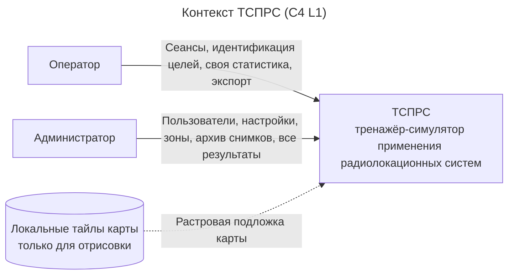

---
aliases:
  - 02-контекст-системы
  - Контекст системы
tags:
  - архитектура
  - ТСПРС
---
## Контекст системы

### Диаграмма контекста

### Участники контекста

| Элемент               | Тип     | Взаимодействие                                                                                                  |
| --------------------- | ------- | --------------------------------------------------------------------------------------------------------------- |
| Оператор              | роль    | Проходит «Тренировку» и «Экзамен», идентифицирует цели, просматривает свою статистику, экспортирует результаты. |
| Администратор         | роль    | Управляет пользователями, настройками, редактором зон, просматривает архив результатов симуляций                |
| ТСПРС                 | система | Эмулятор радиолокационной системы. Интеграция с реальной РЛС не планируется;                                    |
| Локальные тайлы карты | данные  | Растровая подложка карты; статические файлы тайлов с размером в метрах и X/Y верхнего левого угла.              |

### Глоссарий

*Eдиный язык, Ubiquitous Language*

| Термин                                       | Определение                                                                                                                        |
| -------------------------------------------- | ---------------------------------------------------------------------------------------------------------------------------------- |
| Сеанс                                        | Прогон симуляции в режиме «Тренировка» или «Экзамен» с таймером, объектами и результатом.                                          |
| Цель                                         | Обнаруженный объект на карте: точка типа «БВС (беспилотное воздушное судно)» или «Птицы» со скоростью, координатами и траекторией. |
| Зона покрытия радиолокационной системы (РЛС) | Область действия станции; визуализируется радарными кольцами.                                                                      |
| Охраняемая зона                              | Полигон, попадание цели в который создаёт уведомление; охраняемая зона.                                                            |
| Зона игнорирования                           | Полигон, скрывающий цели; при пересечении зон имеет приоритет.                                                                     |
| Тревожное событие                            | Попадание цели в охраняемую зону; инициирует автоматический снимок экрана.                                                         |
| Идентификация                                | Двойное нажатие по цели: «БВС» — верно, «Птицы» — ошибка; повторный клик игнорируется.                                             |
| Результат сеанса                             | Счётчики определённых, верных и ошибочных целей и время реакции на каждую идентифицированную цель.                                 |
| ТСПРС                                        | тренажёр-симулятор применения радиолокационных систем                                                                              |
| РЛС                                          | радиолокационная система                                                                                                           |
| РЛИ                                          | радиолокационное изображение                                                                                                       |
| БАС                                          | беспилотная авиационная система                                                                                                    |
| БВС                                          | беспилотное воздушное судно                                                                                                        |

### Домены системы

| Домен             | Тип             | Состав                                                               |
| ----------------- | --------------- | -------------------------------------------------------------------- |
| Симуляция         | основной        | карта, объекты, зоны, сеанс, идентификация, результат                |
| Администрирование | вспомогательный | пользователи, роли, матрица прав, общие настройки, архив результатов |
