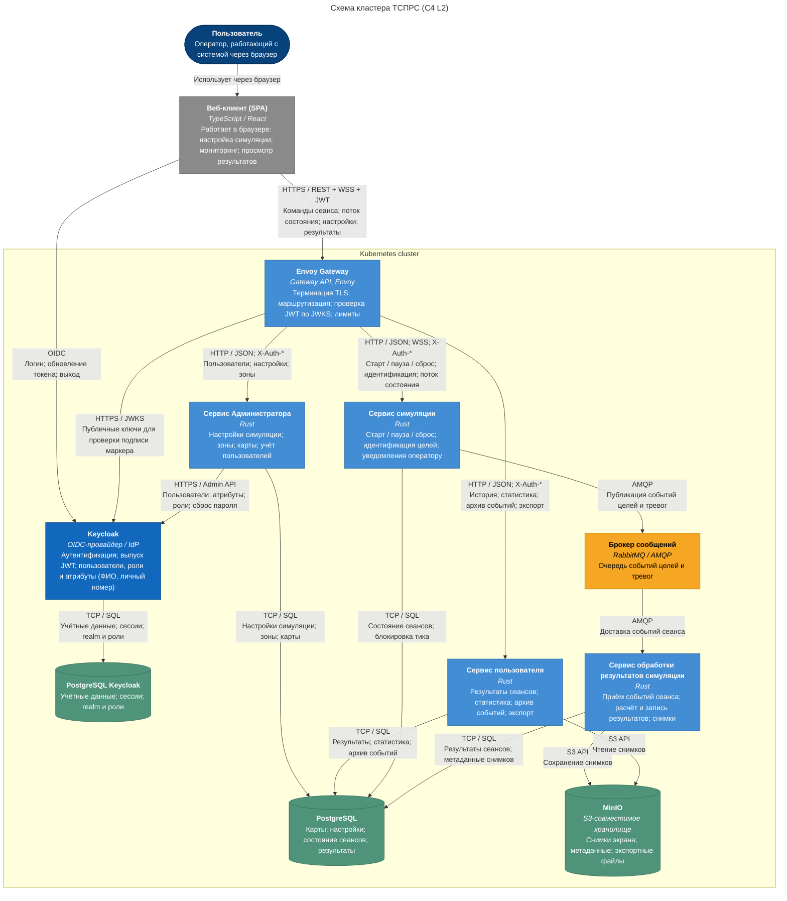

---
aliases:
  - 03-архитектура-приложения
  - Архитектура приложения
tags:
  - архитектура
  - ТСПРС
---
## Архитектура системы

### Диаграмма кластера

### Контейнеры

| Контейнер                              | Технология                    | Ответственность                                                               |
| -------------------------------------- | ----------------------------- | ----------------------------------------------------------------------------- |
| Веб-клиент (SPA)                       | TypeScript / React            | аутентификация через Keycloak, карта, управление сеансом, статистика, экспорт |
| Envoy Gateway                          | Envoy, Kubernetes Gateway API | маршрутизация, проверка JWT, управление нагрузкой траффика                    |
| Keycloak                               | OIDC-провайдер                | аутентификация, выпуск JWT, пользователи и роли                               |
| Сервис Администратора                  | Rust                          | настройки симуляции, зоны, карты, архив результатов.                          |
| Сервис симуляции                       | Rust                          | Генерация и движения объектов, идентификация целей                            |
| Сервис обработки результатов симуляции | Rust                          | обработка результатов симуляций                                               |
| Сервис пользователя                    | Rust                          | архив результатов пользователя,  экспорт результатов, запуск симуляции        |
| PostgreSQL                             | PostgreSQL                    | реляционные данные системы                                                    |
| MinIO                                  | S3-совместимое хранилище      | объектные данные системы                                                      |
| RabbitMQ                               | RabbitMQ / AMQP               | шина обмена событиями для асинхронного межсервисного вазимодействия           |

### Возможности масштабирования

При росте нагрузки основные контейнеры кластера могут быть масштабированы независимо друг от друга.

| Компонент                                                                       | Доступный приём масштабирования                                                                            |
| ------------------------------------------------------------------------------- | ---------------------------------------------------------------------------------------------------------- |
| Веб-клиент                                                                      | статические файлы раздаются Envoy Gateway, кэшируются браузером и на периметре                             |
| Envoy Gateway                                                                   | HPA по CPU и числу соединений, балансировка L7                                                             |
| Сервисы Администратора, обработки результатов симуляции, результатов, симуляции | без состояния. реплики по HPA на основе метрик утилизации CPU, RAM, а так же актуатора liveness.           |
| Keycloak                                                                        | 2+ реплики с общим кэшем Infinispan и внешней PostgreSQL; снижение нагрузки за счёт кэша JWKS на периметре |
| PostgreSQL                                                                      | один первичный узел, реплики для чтения статистики, пул соединений (PgBouncer)                             |
| Брокер сообщений                                                                | узел RabbitMQ может быть масштабирован в кластер с кворумными очередями                                    |
| MinIO                                                                           | объектное хранилище может быть переведено в распределённый режим с несколькими узлами                      |
