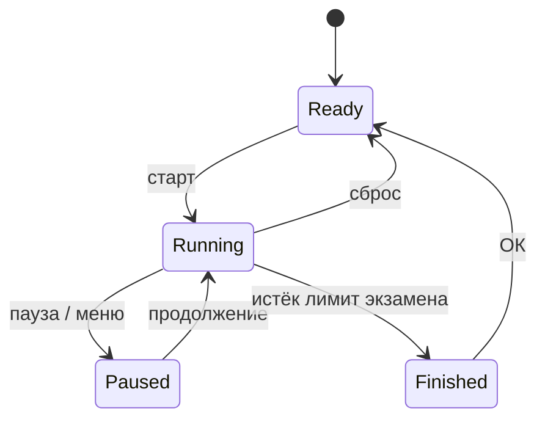

---
aliases:
  - 05-модель-симуляции
  - Модель симуляции
tags:
  - архитектура
  - ТСПРС
---
## Модель симуляции РЛС

### Цикл состояний симуляции



| Состояние  | Поведение                                                     |
| ---------- | ------------------------------------------------------------- |
| `Ready`    | таймер `00:00`, цели не генерируются, команды старта доступны |
| `Running`  | тик 20 Гц: спавн, движение, зоны, уведомления                 |
| `Paused`   | всё замирает; лимит 60 минут, затем возврат в `Ready`         |
| `Finished` | спавн и тик остановлены, результат зафиксирован               |

Режимы: в «Тренировке» таймер считает вверх до паузы, сброс перезапускает сеанс с потерей состояния; в «Экзамене» таймер считает вниз от лимита, заданного в настройках, сброс недоступен, результат сохраняется автоматически.

### Тик и время

- Тик симуляции — 20 Гц (шаг 50 мс), шаг фиксированный; отрисовка клиента (fps) от тика не зависит.
- Пауза не увеличивает время сеанса симуляции.
- Клиент получает состояние 10 раз в секунду по WebSocket и интерполирует положение целей между кадрами.
- Частота тика, seed и поведение у границ карты — параметры реализации, вынесены в конфигурацию сервиса.

### Генерация целей

| Параметр        | БВС                         | Птицы                                 |
| --------------- | --------------------------- | ------------------------------------- |
| Точка появления | случайная в охраняемой зоне | случайная в зоне покрытия             |
| Конечная точка  | случайная в охраняемой зоне | не задаётся                           |
| Скорость, м/с   | 25–35                       | 2–10                                  |
| Курс            | к конечной точке            | произвольный, с постоянным разворотом |
| Время жизни, с  | 10–1800                     | 1–10                                  |
| Траектория      | прямая                      | дуга окружности                       |

Правила:

- одновременно не более `Nmax` объектов (настройка 1–20); освободившееся место занимает новая цель;
- интенсивность спавна и доля типов объектов задаются Администратором;
- значения параметров различаются случайным разбросом внутри диапазонов;

### Модель движения объектов

Обозначения, используемые в формулах:

| Буква      | Смысл                                                     | Единица |
| ---------- | --------------------------------------------------------- | ------- |
| `x`, `y`   | координаты цели в локальной системе с центром в точке РЛС | м       |
| `x0`, `y0` | случайная точка появления в пределах охраняемой зоны      | м       |
| `x1`, `y1` | случайная конечная точка в пределах охраняемой зоны       | м       |
| `d`        | расстояние между точкой появления и конечной точкой       | м       |
| `c0`       | курс — направление вектора скорости птицы                 | рад     |
| `w`        | угловая скорость разворота птицы                          | рад/с   |
| `v`        | модуль скорости цели                                      | м/с     |
| `t`        | время с момента появления цели                            | с       |
| `T`        | время жизни цели                                          | с       |

#### Движение БВС

БВС летит по прямой от случайной точки появления к случайной конечной точке в пределах охраняемой зоны.

```text
d = √((x1 − x0)² + (y1 − y0)²)
x(t) = x0 + (x1 − x0)·v·t/d
y(t) = y0 + (y1 − y0)·v·t/d
```

- `x0`, `y0` — точка появления, `x1`, `y1` — конечная точка;
- `d` — длина прямого маршрута между ними;
	- `√((x1 − x0)² + (y1 − y0)²)`
	- оси x и y ортогональны, значит отрезок между двумя точками — гипотенуза прямоугольного треугольника с катетами `|x1 − x0|`, `|y1 − y0|`
- `v·t/d` — доля маршрута, пройденная за время `t` (от 0 до 1);
- `x(t)`, `y(t)` — положение цели в момент `t`;
- цель снимается при `t = d/v` (достигла конечной точки) или при `t = T`, что наступит раньше.

#### Движение птиц

Птица движется по дуге окружности постоянного радиуса: курс равномерно меняется с угловой скоростью `w`.

```text
c(t) = c0 + w·t
x(t) = x0 + (v/w)·[sin(c0 + w·t) − sin(c0)]
y(t) = y0 − (v/w)·[cos(c0 + w·t) − cos(c0)]
```

пояснения к формулам
- ограничения
	- задано условиями
		- `T` – время детекции птицы `от 1 до 10` с;
		- `v` – скорости птицы `от 2 до 10 м/с`
	- принято для расчетов
		- `v = w·R` скорость движения по окружности,
			- где R - радиус смещения птицы, принимает значения `от 5 до 200 м` при заданном ограничении спорости
- `c0` — начальный курс, `от 0 до 2π рад`
- `w·t` — поворот курса за время `t`, `от 0 до 4 рад`
- `c0 + w·t` — текущий курс, рад;
- `sin(c0 + w·t) − sin(c0)` — безразмерное смещение по x, `от -2 до 2`
- `cos(c0 + w·t) − cos(c0)` — безразмерное смещение по y на той же окружности, `от -2 до 2`;
- `v/w` — радиус разворота, переводит безразмерное смещение в метры;
	- `(v/w)·[…]` — смещение цели по оси от точки появления;
	- знак `w` задаёт направление разворота: плюс — против часовой стрелки, минус — по часовой.

Предельный случай при `w → 0` — траектория вырождается в прямую:
```text
x(t) = x0 + v·cos(c0)·t
y(t) = y0 + v·sin(c0)·t
```

### Зоны

- Зона — полигон с вершинами в локальных метрах, типы: «обнаружение» и «игнорирование»
- При пересечении зон приоритет у зоны игнорирования: цель скрыта и в подсчёт не входит.
- Тревожное событие — первый вход цели в зону обнаружения; повторные входы той же цели событие не создают.
- Геометрия зон берётся из версии, зафиксированной в настройках на момент старта сеанса.

### Идентификация и скоринг

| Действие               | Эффект                                                  |
| ---------------------- | ------------------------------------------------------- |
| Одинарный клик по цели | ничего не происходит                                    |
| Двойной клик по БВС    | счётчик верных +1, цель зелёная, время реакции записано |
| Двойной клик по птице  | счётчик ошибок +1, цель красная                         |
| Повторный клик по цели | игнорируется, состояние и счётчики не меняются          |
| Клик вне цели          | ничего не происходит                                    |

Метрики сеанса: всего целей, верных, ошибок, среднее время реакции, время реакции по каждой цели (для графика и экспорта).

### Результат и сохранение

- Результат формируется при переходе в `Finished`: оператор (`sub` и снимок ФИО), дата, тип записи, счётчики, средние и позиционные время детекции целей.
- Запись результата в систему хранения производится после перехода в `Finished`.
	- В режиме «Тренировка» — сохранение после подтверждения пользователем
	- В режиме «Экзамен» — сохранение автоматически.
- Снимок экрана формируется при тревожном событии.
