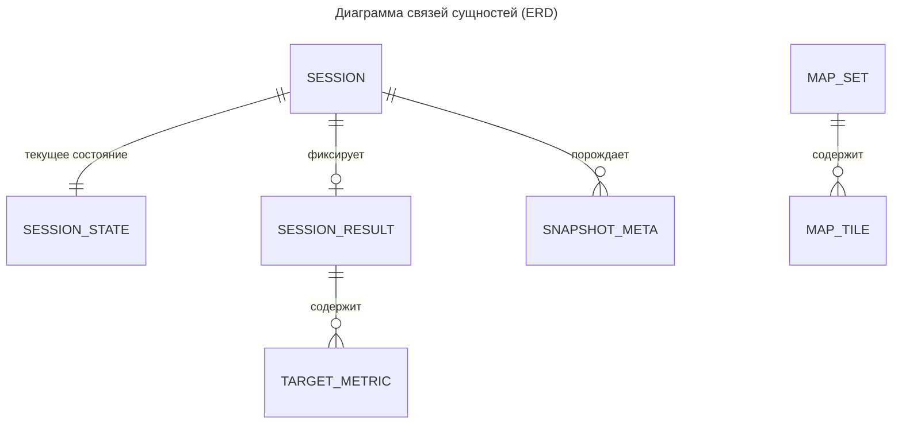

---
aliases:
  - 06-данные-и-хранилища
  - Данные и хранилища
tags:
  - архитектура
  - ТСПРС
---
## Хранение данных системы

### Распределение данных

| Хранилище           | Данные                                                                        | Владелец                                                |
| ------------------- | ----------------------------------------------------------------------------- | ------------------------------------------------------- |
| PostgreSQL          | настройки, зоны, карты, сеансы и их состояние, результаты, метаданные снимков | сервисы Администратора, симуляции, событий, результатов |
| MinIO               | тайлы карт, снимки экрана, файлы экспорта                                     | сервис Администратора, сервис событий и снимков         |
| PostgreSQL Keycloak | учётные данные, роли, атрибуты, сессии                                        | Keycloak                                                |

Схемы в PostgreSQL разделены по сервисам, каждый сервис обращается только к своей схеме: `admin`, `maps`, `sim`, `events`, `results`. Кросс-схемных запросов и общих таблиц нет; ссылки между сервисами — логические идентификаторы.

### Реляционные данные

| Сущность              | Ключевые поля                                                                                                          | Назначение                            |
| --------------------- | ---------------------------------------------------------------------------------------------------------------------- | ------------------------------------- |
| `simulation_settings` | `spawn_intensity`, `max_targets`, `screenshots_enabled`, `exam_duration_s`, `zones_version`, `updated_by`              | общие настройки, последняя версия зон |
| `zone`                | `id`, `type`, `polygon`, `name`, `version`                                                                             | зона обнаружения или игнорирования    |
| `session`             | `id`, `operator_id`, `mode`, `status`, `started_at`, `finished_at`, `settings_version`                                 | метаданные сеанса                     |
| `session_state`       | `session_id`, `targets`, `zones_snapshot`, `elapsed_ms`, `updated_at`                                                  | снимок состояния активного сеанса     |
| `session_lock`        | `session_id`, `instance_id`, `locked_at`                                                                               | блокировка тика одним экземпляром     |
| `session_result`      | `id`, `session_id`, `operator_id`, `operator_name`, `mode`, `total`, `correct`, `wrong`, `avg_reaction_ms`, `saved_at` | сохранённый результат                 |
| `target_metric`       | `result_id`, `target_no`, `target_type`, `reaction_ms`, `is_correct`                                                   | время реакции по цели                 |
| `snapshot_meta`       | `id`, `session_id`, `operator_id`, `captured_at`, `object_key`, `checksum`                                             | метаданные снимка                     |

Модель карты

| Сущность   | Поле                                                           | Назначение                                                                              |
| ---------- | -------------------------------------------------------------- | --------------------------------------------------------------------------------------- |
| `map_set`  | `id`                                                           | идентификатор набора карты                                                              |
| `map_set`  | `version`                                                      | версия набора, часть ключа объекта                                                      |
| `map_set`  | `tile_size_px`                                                 | размер стороны тайла в пикселях (256)                                                   |
| `map_set`  | `min_zoom`, `max_zoom`                                         | диапазон уровней масштаба `zoom`                                                        |
| `map_set`  | `format`                                                       | формат растра (webp, png)                                                               |
| `map_set`  | `bounds_x_min`, `bounds_y_min`, `bounds_x_max`, `bounds_y_max` | границы покрытия версии в локальных метрах, проверяются при сборке                      |
| `map_tile` | `map_set_id`                                                   | набор и версия тайла                                                                    |
| `map_tile` | `zoom`, `x`, `y`                                               | безразмерные целые индексы сетки: `zoom` — уровень масштаба, `x`/`y` — столбец и строка |
| `map_tile` | `size_m`                                                       | размер стороны тайла в метрах                                                           |
| `map_tile` | `object_key`                                                   | ключ объекта растра в MinIO                                                             |
| `map_tile` | `checksum`                                                     | контрольная сумма растра                                                                |

Связи между сущностями данных

### Объектное хранилище

Доступ к бакетам по S3 API. Публичного доступа нет.

| Бакет       | Ключ объекта                                      | Содержание     | Политика                                  |
| ----------- | ------------------------------------------------- | -------------- | ----------------------------------------- |
| `maps`      | `maps/{map_set_id}/{version}/{zoom}/{x}/{y}.webp` | тайлы карт     | только чтение, новая версия — новый набор |
| `snapshots` | `snapshots/{session_id}/{snapshot_id}.png`        | снимки экрана  | общий лимит 100 ГБ, удаление старейших    |
| `exports`   | `exports/{result_id}.json`                        | файлы экспорта | хранение 30 дней                          |
