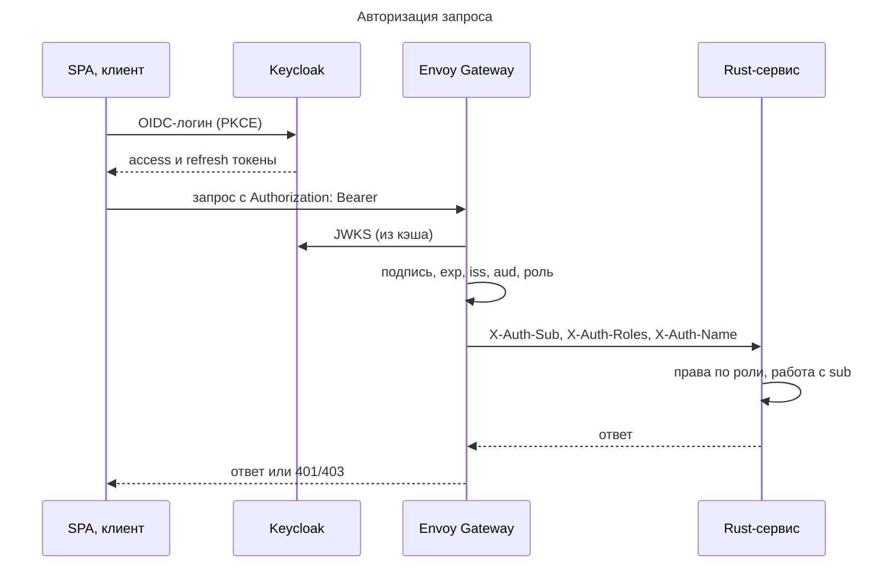

---
aliases:
  - 06-безопасность-и-доступ
  - 07-безопасность-и-доступ
  - Безопасность и доступ
tags:
  - архитектура
  - ТСПРС
---
## Безопасность и доступ

### Аутентификации клиентов

**Аутентификация реализована** на основе JSON Web Token (RFC 7519)

Политики токенов:

| Параметр          | Значение                              |
| ----------------- | ------------------------------------- |
| Аутентичность JWT | Проверка JWT через JWKS               |
| Access-токен      | 5 минут                               |
| Refresh-токен     | 30 минут, продлевается при активности |

Подпись, `exp`, `iss`, `aud` и роль проверяет Envoy Gateway; сервисы получают `sub`, роли и ФИО заголовками `X-Auth-*` и JWT не разбирают. Долгоживущих серверных сессий нет.

**Управление доступом реализовано пр помощи IAM-сервера Keycloak.**

Пользователи, роли и атрибуты хранятся только в Keycloak; в PostgreSQL справочника пользователей нет. Пользователь идентифицируется по `sub` из токена.

Политики Keycloak

| Элемент                 | Значение                       |
| ----------------------- | ------------------------------ |
| Realm                   | `TSPRS`                        |
| Realm-роли              | `operator`, `admin`            |
| Дополнительные атрибуты | `full_name`, `personal_number` |

### Матрица ролей и правилегий

| Функция                                | Оператор | Администратор |
| -------------------------------------- | -------- | ------------- |
| Вход, выход, смена своего пароля       | да       | да            |
| Режим «Тренировка»                     | да       | да            |
| Режим «Экзамен»                        | да       | да            |
| Своя история и статистика              | да       | да            |
| История и статистика других операторов | нет      | да            |
| Экспорт своих результатов              | да       | да            |
| Экспорт любых результатов              | нет      | да            |
| Настройки симуляции                    | нет      | да            |
| Редактор зон и карт                    | нет      | да            |
| Управление пользователями и ролями     | нет      | да            |
| Архив снимков экрана                   | нет      | да            |

### Управление пользователями

- Управление пользователями через Keycloak Admin API из «Сервиса Администратора».
- Стартовая учётная запись Администратора создаётся при инициализации realm; пароль задаётся при первом входе.
- Пользователи не удаляются, а деактивируются: история результатов остаётся связанной с `sub`.
- Смена своего пароля через Keycloak Account API

### Защита API

- Envoy Gateway
	- работает только по HTTPS
	- реализует политики CORS только для разрешенных доменов.
	- Единая точка проверки JWT
	- Envoy подменяет HTTP-заголовки клиента `X-Auth-*`. Сервисы доверяют только заголовкам шлюза.
#### Авторизация запроса клиента

- SPA получает токен у Keycloak и передаёт его в заголовке `Authorization: Bearer`;
- Если токен недостоверный – шлюз прерывает запрос с `401`
- Если токен достоверный – шлюз извлекает реквизиты пользователя и передаёт их целевому сервису в `X-Auth-*` заголовках.

#### Авторизация WebSocket сессии

Сеанс симуляции идёт по WebSocket:
1. Клиент получает одноразовый тикет `POST /api/v1/sessions/{id}/ticket` и открывает `wss://…/api/v1/ws/sessions/{id}?ticket=…`.
2. По соединению сервер отдаёт поток состояния, тревоги и итог сеанса, клиент сообщает события старт, паузу, сброс, идентификации.
3. Время жизни wss тикета ограничено. Время wss сессии ограничено.

## Защита секретов

Секреты сервис кластера (пароль БД, ключи MinIO, service accounts) хранятся во внешнем защищенном хранилище (напр. HashiCorp Vault) с внедренной политикой ротации
