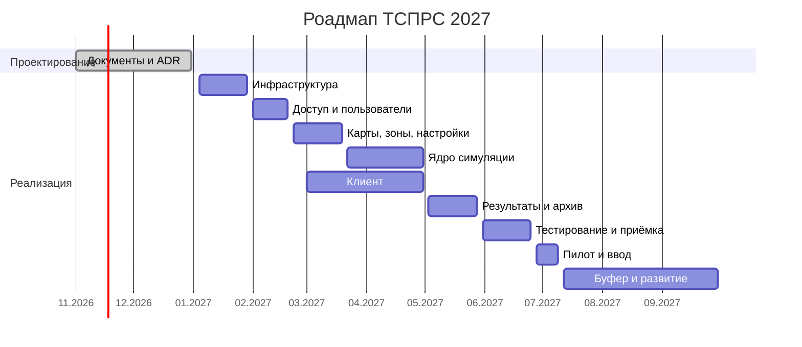

---
aliases:
  - 07-план-работ
  - План работ
tags:
  - план
  - ТСПРС
---
## План работ

### Границы MVP

В MVP входят:

- роли «Оператор» и «Администратор», вход через OIDC, смена пароля, управление пользователями
- режимы работы симулятора «Тренировка» и «Экзамен»
- карта на статических тайлах, радарные кольца, зоны обнаружения и игнорирования
- генерация и движение объектов «БВС» и «Птицы»
- идентификация целей оператором
- хранение результатов сессий

### Этапы

| Этап                          | Критерий готовности                                                                        |
| ----------------------------- | ------------------------------------------------------------------------------------------ |
| 0. Проектирование             | документация согласована, открытые вопросы вынесены на решение                             |
| 1. Инфраструктура             | сервис-заглушка развёрнут, миграции применяются, OIDC-вход проходит                        |
| 2. Доступ и пользователи      | матрица прав проверена автотестами, Оператор не получает доступ к Admin API                |
| 3. Карты, зоны, настройки     | Администратор публикует версию карты и зон, сеанс использует зафиксированную версию        |
| 4. Ядро симуляции             | сеанс воспроизводим по seed, 20 целей без деградации, пауза и продолжение корректны        |
| 5. Клиент                     | сценарии SCR-01…SCR-07 воспроизводятся, интерфейс работает в Chrome и Edge на Windows      |
| 6. Результаты, архив, экспорт | результат сохраняется по правилам режима, снимок доступен в архиве, JSON содержит все поля |
| 7. Тестирование и приёмка     | SL0 выполнен, дефекты нету                                                                 |
| 8. Пилот и ввод               | неделя пилота без инцидентов                                                               |
| 9. Буфер и развитие           | backlog развития согласован                                                                |
### Ресурсы

| Роль | Загрузка, FTE | Ответственность |
| --- | --- | --- |
| Архитектор, тимлид | 0,5 | архитектура, ADR, кросс-командные решения, приёмка |
| Rust-разработчик | 2 | сервисы Администратора, симуляции, результатов, интеграции |
| TypeScript/React-разработчик | 2 | SPA, карта, панели, статистика, экспорт |
| DevOps/SRE | 0,5 | кластер, CI/CD, шлюз, хранилища, мониторинг |
| QA-инженер | 1 | тест-планы, автотесты, нагрузка, приёмка |
| Аналитик/PM | 0,5 | требования, открытые вопросы, планирование, отчётность |
| Представитель заказчика | 0,2 | согласование решений, приёмка, пилот |

Команда — 6–7 человек. Этапы 4 и 5 выполняются параллельно после стабилизации контракта API и протокола WebSocket.

### Роадмап

