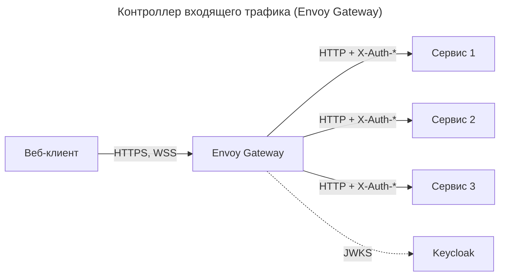

---
aliases:
  - 03-выбор-контроллера-входящего-трафика
  - ADR-03
  - Контроллер входящего трафика
tags:
  - ADR
  - ТСПРС
---
## ADR-03. Контроллер входящего трафика

| Поле    | Значение                                                                       |
| ------- | ------------------------------------------------------------------------------ |
| Статус  | принят                                                                         |
| Дата    | 2026-11-11                                                                     |

### Контекст

Есть внешний клиент с аутентификацией OIDC аутентифкацией. Есть набор внутренних сервисов. Необходимо предусмотреть:
* шлюз управления трафиком
* устойчивость сетевым к атакам
* единую точку аутентификации запосов

### Альтернативы

| Критерий сравнения                       | Ingress NGINX                                  | Envoy Gateway                           | APISIX                            | Kong                                    |
| ---------------------------------------- | ---------------------------------------------- | --------------------------------------- | --------------------------------- | --------------------------------------- |
| Модель конфигурации                      | аннотации Ingress                              | CRD Gateway API: `Gateway`, `HTTPRoute` | CRD и Admin API, состояние в etcd | CRD и Admin API, состояние в PostgreSQL |
| Проверка JWT по JWKS                     | через внешний oauth2-proxy                     | встроенный JWT-фильтр с кэшем JWKS      | доп. плагин                       | доп. плагин                             |
| Передача claim'ов в сервис               | заголовками из субзапроса                      | внутренняя настройка                    | доп. плагин                       | доп. плагин                             |
| WebSocket                                | поддерживается                                 | поддерживается                          | поддерживается                    | поддерживается                          |
| Возможность ограничения частоты запросов | по IP                                          | по IP и по заголовкам                   | плагины                           | плагины                                 |
| Дополнительные зависимости               | oauth2-proxy, второй компонент на пути запроса | нет                                     | etcd                              | PostgreSQL                              |
| Поддержка OpenTelemetry                  | частично                                       | есть                                    | есть                              | есть                                    |
| Итог                                     | —                                              | принят                                  | —                                 | —                                       |

### Решение

Принят **Envoy Gateway**. Он выполняет роль единственной точки проверки подписи JWT и передаёт удостоверенную идентичность сервисам заголовками.

### Обоснование

* JWT-фильтр встроен. Упрощается настройка кластера.
* WebSocket, лимиты, таймауты и CORS настраиваются в одном месте.
